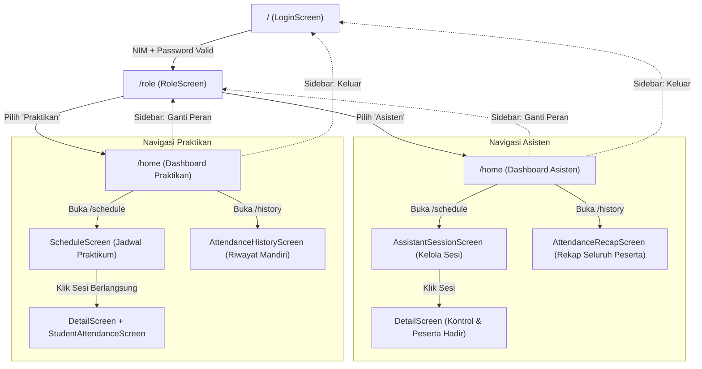
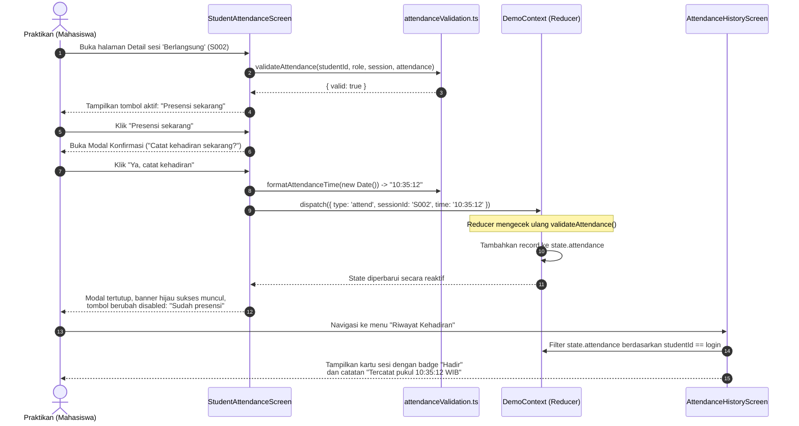

# Arsitektur Aplikasi PraktiKu (Sprint 1 - Presensi Praktikum)

Dokumen ini menjelaskan rancangan arsitektur, struktur folder, alur data, dan mekanisme teknis aplikasi **PraktiKu** untuk persiapan demo praktikum Sprint 1.

---

## 1. Gambaran Arsitektur & Struktur Folder

Aplikasi ini dibangun menggunakan stack modern:
- **Framework**: React Native 0.86.3 dengan **Expo SDK 57** (mendukung Web, Android, dan iOS).
- **Routing**: **Expo Router v57** berbasis file-system (`src/app/`).
- **State Management**: React Context API (`useReducer`) tanpa backend/Firebase luar; data disinkronkan ke `localStorage` pada browser untuk kebutuhan demo.
- **Bahasa**: TypeScript (Strict Mode).

### Pohon Struktur Folder

```
Pertemuan-6/
├── src/
│   ├── app/                      # Expo Router (File-based Routing)
│   │   ├── _layout.tsx           # Root provider wrapper (<DemoProvider>, <Stack>)
│   │   ├── index.tsx             # Route / -> LoginScreen
│   │   ├── role.tsx              # Route /role -> RoleScreen
│   │   ├── home.tsx              # Route /home -> HomeScreen
│   │   ├── schedule.tsx          # Route /schedule -> Switcher Asisten/Praktikan
│   │   ├── detail.tsx            # Route /detail -> DetailScreen
│   │   └── history.tsx           # Route /history -> Switcher Asisten/Praktikan
│   ├── components/               # Komponen UI Reusable
│   │   ├── UI.tsx                # Screen, Card, Button, Modal, Sidebar, Icon
│   │   └── SessionStatusBadge.tsx# Badge status sesi praktikum
│   ├── context/
│   │   └── DemoContext.tsx       # State global & sinkronisasi localStorage
│   ├── data/
│   │   ├── dummy.ts              # Data awal (initialSessions & initialAttendanceRecords)
│   │   └── demo-state.ts         # Reducer, validasi state, action types
│   ├── screens/                  # Implementasi Halaman UI
│   │   ├── LoginScreen.tsx
│   │   ├── RoleScreen.tsx
│   │   ├── HomeScreen.tsx
│   │   ├── ScheduleScreen.tsx
│   │   ├── AssistantSessionScreen.tsx
│   │   ├── DetailScreen.tsx
│   │   ├── StudentAttendanceScreen.tsx   # [Bagian Fazl] Presensi Praktikan
│   │   ├── AttendanceHistoryScreen.tsx   # [Bagian Fazl] Riwayat Kehadiran Praktikan
│   │   └── AttendanceRecapScreen.tsx     # Rekap Asisten
│   ├── styles/                   # Tema warna dan stylesheet terpadu
│   │   ├── dashboard.ts
│   │   └── theme.ts
│   ├── types/
│   │   └── index.ts              # Tipe TypeScript (PracticalSession, AttendanceRecord, dsb.)
│   └── utils/
│       └── attendanceValidation.ts       # [Bagian Fazl] Validasi presensi & format WIB
├── package.json
└── tsconfig.json
```

---

## 2. Penjelasan Halaman UI & Lokasi File

| Halaman | Rute URL | Lokasi File Komponen | Penjelasan Fungsi |
| :--- | :--- | :--- | :--- |
| **Login** | `/` | [LoginScreen.tsx](file:///D:/Semester-5/Prak%20PPK/Pertemuan-6/src/screens/LoginScreen.tsx) | Form input NIM & password demo (`12345678`), validasi input kosong/salah. |
| **Pilih Peran** | `/role` | [RoleScreen.tsx](file:///D:/Semester-5/Prak%20PPK/Pertemuan-6/src/screens/RoleScreen.tsx) | Pemilihan mode kerja antara **Praktikan** atau **Asisten**. |
| **Dashboard** | `/home` | [HomeScreen.tsx](file:///D:/Semester-5/Prak%20PPK/Pertemuan-6/src/screens/HomeScreen.tsx) | Ringkasan metrik (sesi aktif, progress presensi), banner sambutan, akses cepat, dan daftar sesi berlangsung. |
| **Jadwal (Praktikan)** | `/schedule` | [ScheduleScreen.tsx](file:///D:/Semester-5/Prak%20PPK/Pertemuan-6/src/screens/ScheduleScreen.tsx) | Filter tab sesi (`Semua`, `Belum Dibuka`, `Berlangsung`, `Selesai`) dan daftar kartu jadwal praktikan. |
| **Kelola Sesi (Asisten)** | `/schedule` | [AssistantSessionScreen.tsx](file:///D:/Semester-5/Prak%20PPK/Pertemuan-6/src/screens/AssistantSessionScreen.tsx) | Pengawasan sesi asisten, tombol buka sesi, tombol tutup sesi dengan modal konfirmasi. |
| **Detail Sesi** | `/detail` | [DetailScreen.tsx](file:///D:/Semester-5/Prak%20PPK/Pertemuan-6/src/screens/DetailScreen.tsx) | Informasi lengkap praktikum. Jika Asisten: tombol kontrol dan daftar peserta hadir. Jika Praktikan: memuat `StudentAttendanceScreen`. |
| **Kartu Presensi** | (Embedded) | [StudentAttendanceScreen.tsx](file:///D:/Semester-5/Prak%20PPK/Pertemuan-6/src/screens/StudentAttendanceScreen.tsx) | **Bagian Fazl**: Kartu presensi mandiri praktikan, tombol `Presensi sekarang`, dialog modal konfirmasi, pesan feedback sukses hijau. |
| **Riwayat (Praktikan)**| `/history` | [AttendanceHistoryScreen.tsx](file:///D:/Semester-5/Prak%20PPK/Pertemuan-6/src/screens/AttendanceHistoryScreen.tsx) | **Bagian Fazl**: Riwayat kehadiran khusus mahasiswa login, metrik hadir, status badge, waktu presensi WIB, tautan detail sesi. |
| **Rekap (Asisten)** | `/history` | [AttendanceRecapScreen.tsx](file:///D:/Semester-5/Prak%20PPK/Pertemuan-6/src/screens/AttendanceRecapScreen.tsx) | Rekapitulasi seluruh peserta hadir per sesi atau gabungan, filter sesi, NIM mahasiswa, dan waktu presensi. |

---

## 3. Alur Navigasi Asisten dan Praktikan

Rute `/schedule` dan `/history` menggunakan teknik **Dynamic Route Switching** berbasis `state.role`:



Kode pengalihan rute pada [schedule.tsx](file:///D:/Semester-5/Prak%20PPK/Pertemuan-6/src/app/schedule.tsx):
```typescript
export default function ScheduleRoute() {
  const { state } = useDemo();
  return state.role === 'Asisten' ? <AssistantSessionScreen /> : <ScheduleScreen />;
}
```

---

## 4. Cara Kerja React Context, useReducer, useState, dan Data Dummy

Aplikasi tidak menggunakan Firebase atau server backend, melainkan arsitektur **in-memory reactive state** dengan persistensi browser:

```
[initialSessions & initialAttendanceRecords] (dummy.ts)
                          ↓
                  [initialState]
                          ↓
[DemoProvider (DemoContext.tsx)] ←→ [localStorage: 'presensi-praktikum-demo-v1']
        │
   useReducer(demoReducer, initialState)
        │
        ├── state (username, role, sessions, attendance)
        └── dispatch(action)
```

### 1. `useReducer` & `demoReducer`
Semua perubahan state global dikendalikan secara murni (pure function) oleh `demoReducer` pada [demo-state.ts](file:///D:/Semester-5/Prak%20PPK/Pertemuan-6/src/data/demo-state.ts).
Action yang didukung:
- `'login'`: Menyimpan username yang diinput.
- `'role'`: Menentukan peran aktif (`'Asisten'` atau `'Praktikan'`).
- `'open'` & `'close'`: Mengubah status sesi (`Belum Dibuka` -> `Berlangsung` -> `Selesai`). Hanya diizinkan untuk Asisten.
- `'attend'`: Menambahkan catatan kehadiran baru setelah lolos validasi ganda.
- `'restore'`: Memuat kembali snapshot state dari `localStorage`.
- `'logout'`: Mengosongkan username dan peran.

### 2. `DemoContext` & Sinkronisasi `localStorage`
Pada [DemoContext.tsx](file:///D:/Semester-5/Prak%20PPK/Pertemuan-6/src/context/DemoContext.tsx):
- Saat aplikasi dimuat, `useEffect` membaca `localStorage.getItem('presensi-praktikum-demo-v1')`. Jika datanya valid (`isDemoState(parsed)`), state diisi ulang (`dispatch({ type: 'restore' })`).
- Setiap kali `state` berubah, `useEffect` kedua otomatis menyimpan snapshot `JSON.stringify(state)` ke `localStorage`.

### 3. `useState` (State Lokal)
Digunakan hanya untuk state UI yang bersifat sementara dan tidak perlu dibagikan antar halaman:
- `LoginScreen`: Nilai teks `username`, `password`, toggle `visible`, dan `message` error.
- `StudentAttendanceScreen`: Boolean `confirming` untuk menampilkan/menyembunyikan modal konfirmasi presensi.
- `AssistantSessionScreen`: Filter kategori status (`Semua`, `Belum Dibuka`, dll.) dan ID sesi yang sedang dikonfirmasi tutup (`closingSessionId`).
- `UI.tsx (Sidebar)`: Boolean `open` untuk drawer menu navigasi.

### 4. Data Dummy Awal
Didefinisikan di [dummy.ts](file:///D:/Semester-5/Prak%20PPK/Pertemuan-6/src/data/dummy.ts):
- `S001`: Pemrograman Bergerak (`Belum Dibuka`)
- `S002`: Basis Data (`Berlangsung`) — telah terisi kehadiran awal mahasiswa Cindy
- `S003`: Jaringan Komputer (`Selesai`)

---

## 5. Alur Presensi: Dari Tombol Sampai Riwayat



---

## 6. Penjelasan Tiga File Bagian Fazl

### A. [attendanceValidation.ts](file:///D:/Semester-5/Prak%20PPK/Pertemuan-6/src/utils/attendanceValidation.ts)
Modul utilitas murni (pure utility functions) untuk validasi bisnis dan formatting waktu:
1. **`validateAttendance(input)`**:
   Mengecek 6 kondisi presensi secara berurutan dan mengembalikan kode serta pesan error:
   - `identity`: Mahasiswa belum login / NIM kosong.
   - `role`: Peran saat ini bukan `'Praktikan'`.
   - `session`: Sesi praktikum tidak ditemukan di state.
   - `duplicate`: Mahasiswa sudah pernah presensi pada sesi ini.
   - `unopened`: Status sesi masih `'Belum Dibuka'`.
   - `closed`: Status sesi sudah `'Selesai'`.
2. **`formatAttendanceTime(date)`**:
   Mengonversi objek `Date` menjadi string waktu lokal 24 jam dengan zona waktu Jakarta (`Asia/Jakarta`).

### B. [StudentAttendanceScreen.tsx](file:///D:/Semester-5/Prak%20PPK/Pertemuan-6/src/screens/StudentAttendanceScreen.tsx)
Komponen kartu interaktif presensi mahasiswa yang di-embed ke dalam [DetailScreen.tsx](file:///D:/Semester-5/Prak%20PPK/Pertemuan-6/src/screens/DetailScreen.tsx):
- **Modal Konfirmasi**: Mencegah presensi tidak sengaja. Menggunakan komponen `<Modal>` React Native dengan backdrop semi-transparan dan tombol batal.
- **Dynamic Feedback**:
  - Jika belum presensi: Menampilkan badge `'Belum presensi'` dan tombol `'Presensi sekarang'`.
  - Jika sudah presensi: Menampilkan kotak hijau dengan teks `"Kehadiran berhasil tercatat"` beserta jam presensi, dan tombol menjadi `'Sudah presensi'` (`disabled={true}`).
- **Dual-Layer Guard**: Tombol konfirmasi di dalam modal menolak eksekusi jika validasi tidak lolos.

### C. [AttendanceHistoryScreen.tsx](file:///D:/Semester-5/Prak%20PPK/Pertemuan-6/src/screens/AttendanceHistoryScreen.tsx)
Halaman riwayat personal untuk mahasiswa yang login:
- **Isolasi Data**: Hanya menampilkan data mahasiswa yang bersangkutan menggunakan filter:
  ```typescript
  const mine = state.attendance.filter((record) => record.studentId === state.username);
  ```
- **Statistik Kehadiran**: Menampilkan kotak rasio sesi yang dihadiri vs total sesi praktikum.
- **Empty State**: Menampilkan pesan informatif jika mahasiswa belum pernah melakukan presensi sama sekali.
- **Status Per Sesi**: Menampilkan status badge dinamis (`Hadir`, `Belum presensi`, atau `Tidak presensi` untuk sesi yang sudah ditutup) serta waktu presensi WIB.

---

## 7. Cara Validasi Presensi Ganda & Format Waktu WIB

### 1. Pencegahan Presensi Ganda (Duplicate Validation)
Pencegahan duplikasi diterapkan pada dua lapis (Dual-Layer Protection):

1. **Lapis 1 — Validasi UI (`StudentAttendanceScreen.tsx`)**:
   Memanggil `validateAttendance(...)` sebelum tombol dapat diklik:
   ```typescript
   // src/utils/attendanceValidation.ts
   if (attendance.some((record) => record.sessionId === session.id && record.studentId === studentId)) {
     return { valid: false, code: 'duplicate', message: 'Kehadiranmu sudah tercatat untuk sesi ini.' };
   }
   ```
   Jika record sudah ada, `validation.valid` bernilai `false`, label tombol berubah menjadi `"Sudah presensi"`, dan prop `disabled={true}` aktif.

2. **Lapis 2 — Guard di dalam Reducer (`demo-state.ts`)**:
   Reducer tidak mempercayai UI begitu saja. Saat action `'attend'` diterima, reducer mengecek kembali ke state terbaru:
   ```typescript
   // src/data/demo-state.ts
   case 'attend': {
     if (!validateAttendance({
       studentId: state.username,
       role: state.role,
       session: state.sessions.find((session) => session.id === action.sessionId),
       attendance: state.attendance,
     }).valid) return state; // Menolak jika sudah ada di state
     
     return {
       ...state,
       attendance: [...state.attendance, {
         id: `${action.sessionId}:${state.username}`, // ID unik komposit
         sessionId: action.sessionId,
         studentId: state.username,
         studentName: state.username,
         attendanceTime: action.time,
       }],
     };
   }
   ```
   ID record menggunakan format `${action.sessionId}:${state.username}`, menjamin keunikan record.

### 2. Pencatatan Waktu Aktual WIB
Pencatatan waktu kehadiran menggunakan fungsi `formatAttendanceTime`:
```typescript
// src/utils/attendanceValidation.ts
export function formatAttendanceTime(date: Date): string {
  return date.toLocaleTimeString('id-ID', {
    timeZone: 'Asia/Jakarta',
    hour12: false,
    hour: '2-digit',
    minute: '2-digit',
    second: '2-digit',
  }).replaceAll('.', ':');
}
```
**Mengapa penting?**
- Penggunaan `timeZone: 'Asia/Jakarta'` menjamin jam yang tercatat selalu Waktu Indonesia Barat (WIB), meskipun penguji menjalankan laptop dengan zona waktu WITA, WIT, atau zona waktu luar negeri.
- `hour12: false` memastikan format 24 jam (misal `14:05:09` bukan `02:05:09 PM`).
- `.replaceAll('.', ':')` menjaga keseragaman format pemisah titik dua sesuai standar UI.

---

## 8. Hubungan Fitur Novelya, Iza, dan Fazl

Fitur Sprint 1 saling terhubung secara reaktif dalam satu alur kerja terpadu:

```
[Novelya Cherina]
- Jadwal Praktikum (ScheduleScreen)
- Rute & Navigasi (DetailScreen & Sidebar)
- Pemilihan Peran (RoleScreen)
         │
         ▼
[Iza Yunus Andhika] ────────── Buka Sesi ('Berlangsung') ─────────┐
- Kontrol Sesi Asisten                                            │
- Rekap Kehadiran Asisten                                         ▼
                                                       [Fazl Nizam Priyambodho]
                                                       - Presensi Praktikan (StudentAttendanceScreen)
                                                       - Validasi Duplikasi & Format WIB
                                                       - Riwayat Kehadiran (AttendanceHistoryScreen)
                                                                  │
[Iza Yunus Andhika] ◄──────── Presensi Baru Masuk ke State ───────┘
- Peserta muncul di Rekap Asisten
- Tutup Sesi ('Selesai')
```

1. **Novelya** menyediakan fondasi navigasi global, pemilihan peran, daftar jadwal, dan kerangka halaman detail sesi.
2. **Iza** (sebagai Asisten) membuka sesi yang berstatus `'Belum Dibuka'` menjadi `'Berlangsung'` melalui tombol kontrol sesi.
3. **Fazl** (sebagai Praktikan) mendeteksi perubahan status sesi tersebut secara otomatis. Praktikan membuka detail sesi, melakukan presensi dengan validasi anti-duplikasi, mencatat waktu WIB, dan melihat riwayat kehadiran pribadinya.
4. Data presensi yang baru dicatat Fazl langsung terhubung ke layar rekap kehadiran **Iza** secara real-time karena berada di dalam satu Context yang sama.
5. **Cindy** (Project Manager) memastikan pembagian tugas dan kebutuhan sprint backlog terpenuhi.

---

## 9. Pertanyaan Teknis Asisten & Jawaban Singkat (Cheat Sheet)

### Q1: Mengapa aplikasi tidak menggunakan Firebase atau SQLite?
> **Jawaban**: Sesuai batasan Sprint 1, fokusnya adalah arsitektur frontend, interaksi state, dan validasi logika presensi. State dikelola terpusat menggunakan React Context (`useReducer`) dengan sinkronisasi `localStorage` browser agar data tetap tersimpan saat reload halaman selama demo.

### Q2: Bagaimana cara mencegah praktikan melakukan presensi dua kali?
> **Jawaban**: Kami menerapkan *Dual-Layer Validation*. Pada UI, `validateAttendance` memeriksa apakah kombinasi `sessionId` dan `studentId` sudah ada di array `state.attendance`. Jika sudah ada, tombol langsung di-disable dengan label "Sudah presensi". Pada level reducer, pengecekan yang sama diulang sebelum state dimutasi, sehingga presensi ganda mustahil terjadi.

### Q3: Mengapa menggunakan `useReducer` bukan hanya `useState` biasa di Context?
> **Jawaban**: Karena logika perubahan state presensi melibatkan beberapa entitas yang saling terkait (sesi dan data presensi). `useReducer` membuat transisi state bersifat *predictable*, mudah diuji (unit testing), dan memisahkan logika bisnis (seperti validasi dan perubahan status sesi) dari tampilan UI.

### Q4: Mengapa rute `/schedule` dan `/history` menampilkan halaman berbeda untuk Asisten dan Praktikan?
> **Jawaban**: Kami menggunakan *Dynamic Component Switching* di dalam file rute Expo Router (`schedule.tsx` dan `history.tsx`). Rute memeriksa `state.role`. Jika Asisten, rute me-render layar kontrol/rekap asisten; jika Praktikan, rute me-render layar jadwal/riwayat mahasiswa. Ini menjaga URL tetap bersih dan konsisten.

### Q5: Bagaimana Anda memastikan waktu presensi selalu akurat di zona WIB?
> **Jawaban**: Kami menggunakan fungsi `formatAttendanceTime()` yang memanfaatkan `Intl.DateTimeFormat` via `toLocaleTimeString('id-ID', { timeZone: 'Asia/Jakarta', hour12: false })`. Ini menjamin waktu yang dihasilkan selalu zona WIB (UTC+7) terlepas dari perbedaan zona waktu perangkat lokal pengguna.

### Q6: Bagaimana data presensi bisa langsung muncul di rekap Asisten setelah Praktikan presensi?
> **Jawaban**: Karena kedua peran berada di bawah `DemoProvider` yang sama. Ketika praktikan men-dispatch action `'attend'`, array `state.attendance` diperbarui di root context. Setiap komponen yang berlangganan melalui `useDemo()` (termasuk `AttendanceRecapScreen` dan `DetailScreen` Asisten) akan menerima state terbaru dan otomatis re-render seketika.
