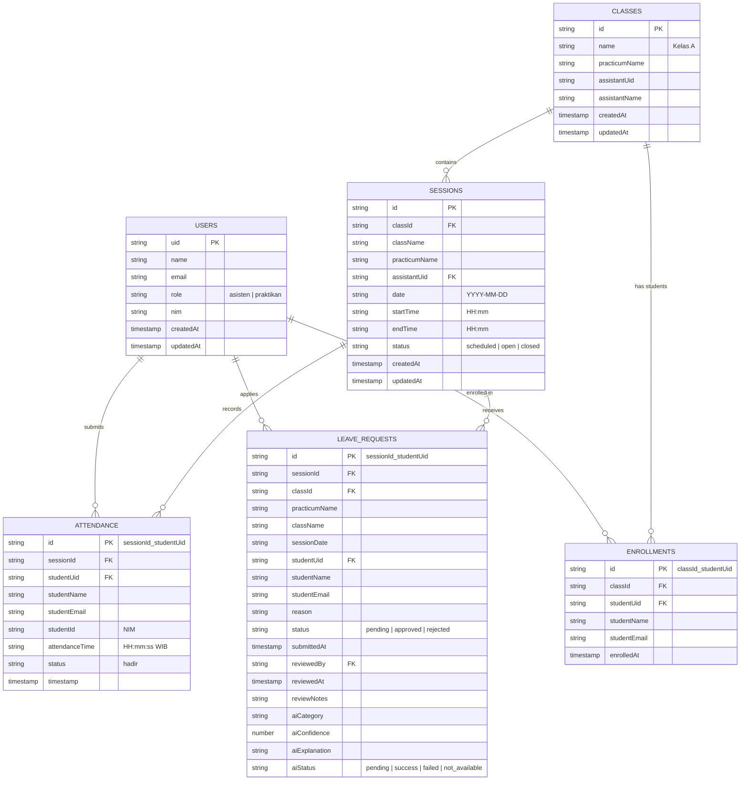
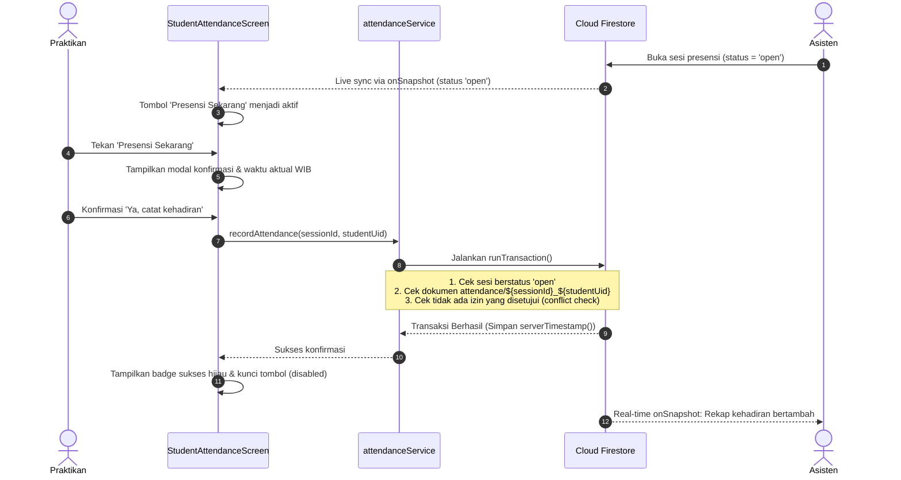
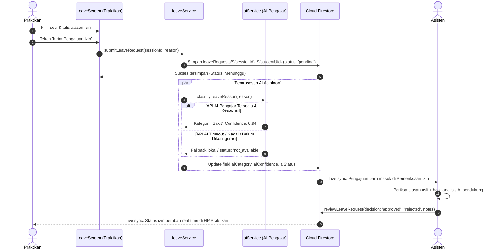

# Arsitektur Aplikasi PraktiKu — Sprint 2

Dokumen ini menjelaskan arsitektur sistem, struktur folder, desain database Cloud Firestore, aturan keamanan Security Rules, alur presensi atomik, alur pengajuan izin, dan mekanisme integrasi AI pada aplikasi **PraktiKu**.

---

## 1. Gambaran Arsitektur & Struktur Folder

Aplikasi dirancang menggunakan arsitektur modular yang memisahkan UI, hooks/context, services, types, dan business logic:

```
Pertemuan-7/
├── assets/                       # Aset ikon dan gambar
├── docs/                         # Dokumentasi Sprint 2
│   ├── SPRINT2_SETUP.md          # Panduan instalasi & konfigurasi
│   ├── SPRINT2_ARCHITECTURE.md   # Desain arsitektur & database
│   ├── SPRINT2_TESTING.md        # Matriks pengujian TC-01 s/d TC-30
│   ├── SPRINT2_DEMO.md           # Panduan demo dua akun & script
│   └── SPRINT2_PROGRESS.md       # Catatan progres fase pengerjaan
├── scripts/                      # Skrip pengujian & seed data
│   ├── seed-demo-data.cjs        # Seeding data akun & sesi contoh
│   ├── test-demo-state.cjs       # Pengujian logika reducer Sprint 1
│   └── test-sprint2.cjs          # Pengujian 30 test case Sprint 2
├── src/
│   ├── app/                      # Expo Router File-Based Routing
│   │   ├── _layout.tsx           # Root provider (AuthProvider, DemoProvider, Stack)
│   │   ├── index.tsx             # Rute / -> LoginScreen
│   │   ├── register.tsx          # Rute /register -> RegisterScreen
│   │   ├── home.tsx              # Rute /home -> HomeScreen
│   │   ├── schedule.tsx          # Rute /schedule -> Switcher Asisten/Praktikan
│   │   ├── detail.tsx            # Rute /detail -> DetailScreen & Presensi
│   │   ├── leave.tsx             # Rute /leave -> Izin Praktikum & Review Asisten
│   │   ├── classes.tsx           # Rute /classes -> Manajemen Kelas (Asisten)
│   │   ├── history.tsx           # Rute /history -> Riwayat (Praktikan) / Rekap (Asisten)
│   │   ├── profile.tsx           # Rute /profile -> Profil, Role Status, Logout
│   │   └── role.tsx              # Rute /role -> Verifikasi Peran & Demo Switcher
│   ├── components/               # Komponen Antarmuka Reusable
│   │   ├── UI.tsx                # Screen, Card, Button, Modal, Sidebar, Icon
│   │   └── SessionStatusBadge.tsx# Badge status sesi praktikum
│   ├── config/
│   │   └── firebase.ts           # Inisialisasi Firebase App, Auth, & Firestore
│   ├── context/
│   │   ├── AuthContext.tsx       # State autentikasi Firebase & sync role Firestore
│   │   └── DemoContext.tsx       # State lokal fallback Sprint 1
│   ├── data/
│   │   ├── demo-state.ts         # Reducer state bawaan
│   │   └── dummy.ts              # Data awal fallback
│   ├── screens/                  # Implementasi Layar Antarmuka
│   │   ├── LoginScreen.tsx       # Login email & password + bypass sesi
│   │   ├── RegisterScreen.tsx    # Registrasi akun Praktikan
│   │   ├── HomeScreen.tsx        # Dashboard dinamis sesuai role
│   │   ├── ScheduleScreen.tsx    # Jadwal praktikan real-time
│   │   ├── AssistantSessionScreen.tsx # Manajemen sesi & buka/tutup presensi
│   │   ├── DetailScreen.tsx      # Detail sesi & peserta hadir
│   │   ├── StudentAttendanceScreen.tsx # Kartu presensi mandiri & modal konfirmasi
│   │   ├── LeaveScreen.tsx       # Pengajuan izin, AI status, & review asisten
│   │   ├── ClassesScreen.tsx     # CRUD kelas praktikum asisten
│   │   ├── AttendanceHistoryScreen.tsx # Riwayat presensi mahasiswa
│   │   ├── AttendanceRecapScreen.tsx   # Rekap kehadiran real-time asisten
│   │   ├── ProfileScreen.tsx     # Profil pengguna & pengangkatan akun demo
│   │   └── RoleScreen.tsx        # Informasi otorisasi peran
│   ├── services/                 # Layer Komunikasi Firebase & API Luar
│   │   ├── authService.ts        # Register, Login, Logout, User Profile Sync
│   │   ├── classService.ts       # CRUD kelas & pendaftaran kelas
│   │   ├── sessionService.ts     # CRUD sesi, open/close status
│   │   ├── attendanceService.ts  # Presensi atomik & kalkulasi rekap
│   │   ├── leaveService.ts       # Pengajuan izin, review asisten, async AI
│   │   └── aiService.ts          # Adapter API AI Pengajar & fallback lokal
│   ├── styles/                   # Tema warna terpadu & layout
│   │   ├── dashboard.ts
│   │   └── theme.ts
│   ├── types/                    # Definisi tipe TypeScript
│   │   └── index.ts
│   └── utils/
│       └── attendanceValidation.ts # Validasi bisnis presensi terpusat
├── firestore.rules               # Aturan keamanan database Cloud Firestore
├── firebase.json                 # Konfigurasi emulator suite Firebase
├── package.json
└── tsconfig.json
```

---

## 2. Desain Skema Database Cloud Firestore



---

## 3. Mekanisme Keamanan Firestore (`firestore.rules`)

1. **Prinsip Default Deny**: Seluruh jalur yang tidak secara tegas diizinkan ditolak (`allow read, write: if false;`).
2. **Pencegahan Kenaikan Peran Ilegal**: Pembuatan akun publik hanya dapat menetapkan `role: 'praktikan'`. Aturan `update` pada `users/{uid}` melarang mahasiswa mengubah field `role`.
3. **Pencegahan Pemalsuan UID**: Setiap dokumen presensi dan izin wajib memverifikasi bahwa field `studentUid == request.auth.uid`.
4. **ID Dokumen Deterministik**: ID dokumen presensi dan izin dibentuk dari format `${sessionId}_${studentUid}`. Firestore secara alami menolak pembuatan dokumen baru jika ID sudah ada, mencegah duplikasi presensi atau izin ganda secara mutlak.
5. **Validasi Status Sesi**: Presensi hanya dapat dibuat jika `get(/databases/.../sessions/$(sessionId)).data.status in ['open', 'Berlangsung']`.
6. **Integritas Keputusan Izin**: Praktikan dilarang mengubah status izin menjadi `approved`. Hanya asisten sesi yang memiliki wewenang meninjau dan menetapkan status keputusan.

---

## 4. Alur Presensi Atomik & Bebas Duplikasi



---

## 5. Alur Pengajuan Izin & Integrasi AI



---

## 6. Ketahanan Sistem (Error Handling & Offline Resilience)

- **AI API Fail-Safe**: Kegagalan koneksi atau timeout pada endpoint AI tidak pernah membatalkan pengajuan izin mahasiswa. Dokumen tetap berstatus `pending` dan asisten tetap dapat mengambil keputusan secara manual.
- **Pembersihan Listener Real-Time**: Seluruh hook dan subscriptions `onSnapshot` secara konsisten mengembalikan fungsi `unsubscribe()` yang dipanggil saat unmount atau saat pengguna logout, mencegah memory leak.
- **Isolasi Identitas**: Query dan listener Firestore disaring berdasarkan UID pengguna aktif, memastikan mahasiswa hanya menerima data hak miliknya.
